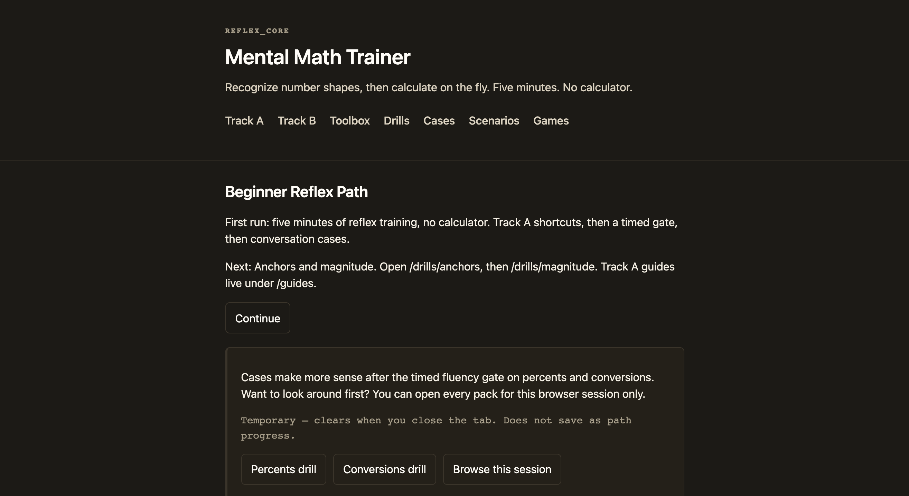
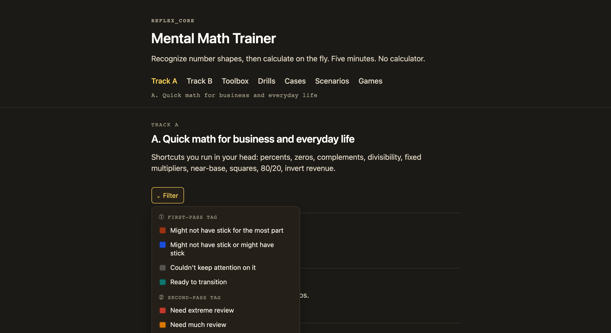
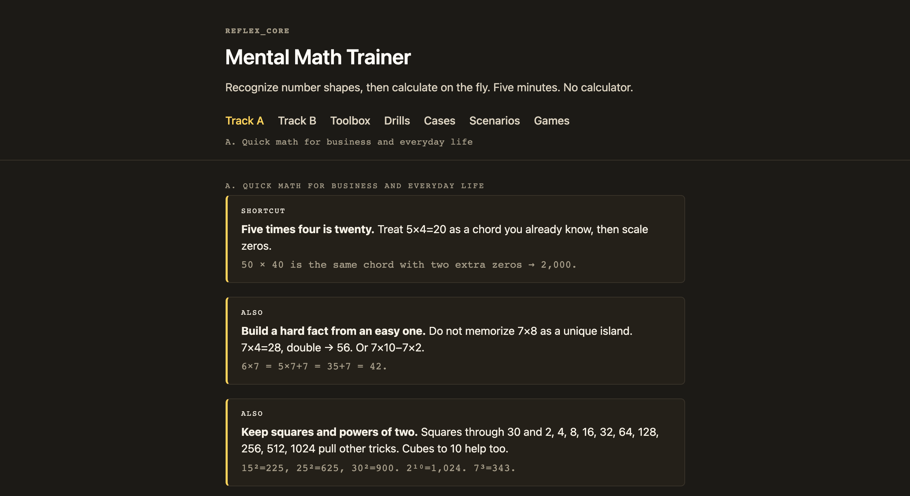
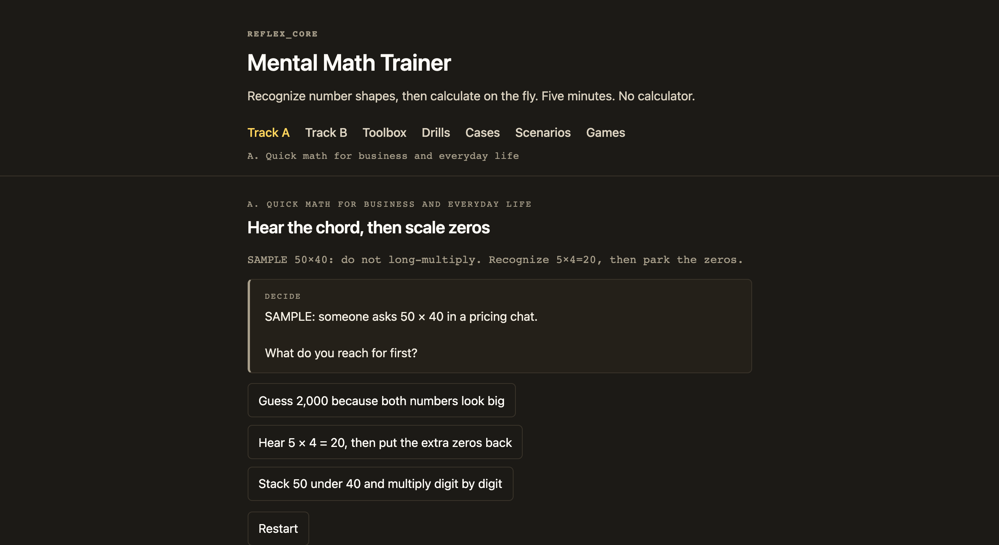
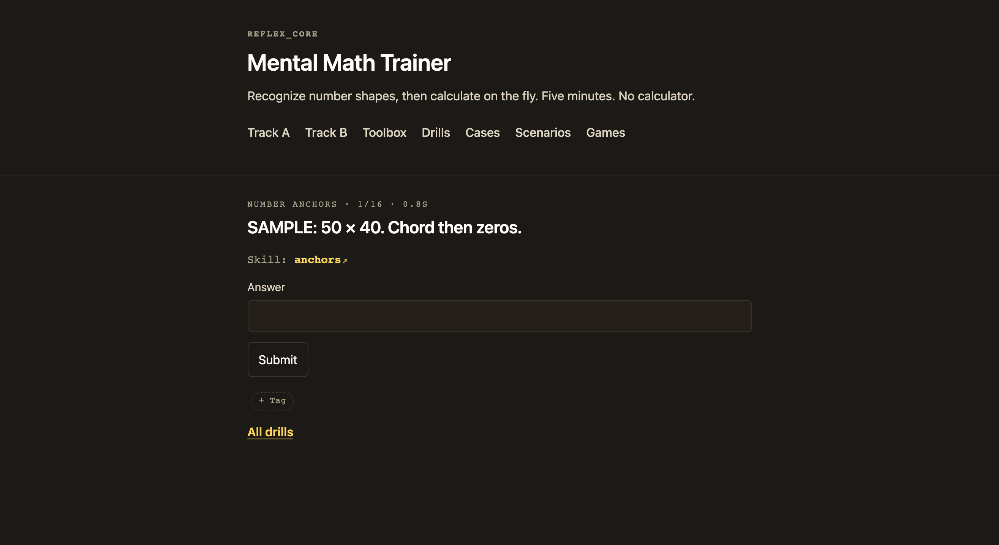
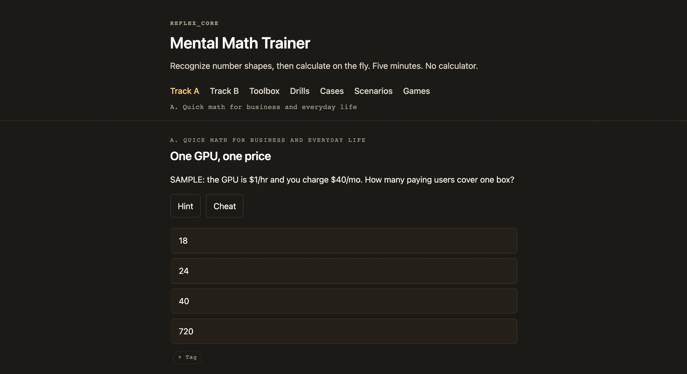
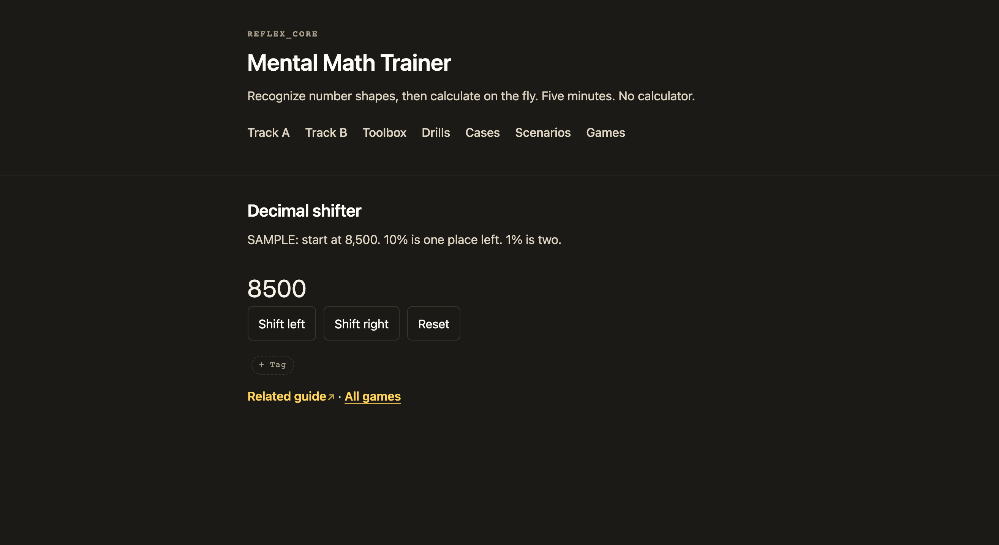
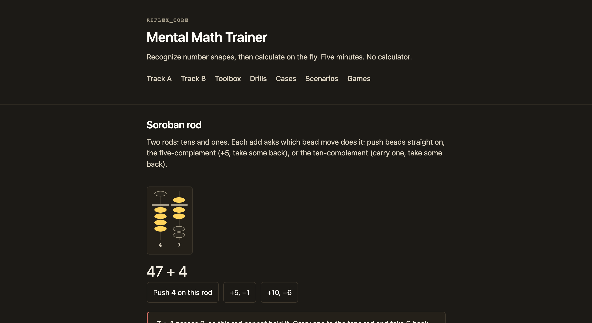

# Mental Math Trainer

By Weng (Weng Fei Fung) 
<a target="_blank" href="https://github.com/Siphon880gh" rel="nofollow"></a>
<a target="_blank" href="https://www.linkedin.com/in/weng-fung/" rel="nofollow"></a>
<a target="_blank" href="https://www.youtube.com/@WengTeachesCode/" rel="nofollow"></a>

Learn mental math for everyday life and business meetings.

Recognize number shapes, then calculate on the fly. Five minutes. No calculator. Every prompt uses SAMPLE numbers only.

## Screenshots

Home is the Beginner Reflex Path — Track A shortcuts, a timed drill gate, then conversation cases. The logo in the header returns here; there is no separate Home nav link.



Track A is everyday and business fluency. Track B is stakeholder and planning math. Tag a guide on first pass or second pass, then filter the list (OR match), same pattern as [leetcode-coach](https://github.com/Siphon880gh/leetcode-coach).



Each guide has a shortcut, the principle, and a link to the step-by-step coach on the same slug:



The coach is a choice tree: wrong path explains, then rewinds. Step back, restart, and a path trail stay on the page.



Timed drills are typed banks. Cases stay locked until percents (median ≤5s) and conversions (median ≤6s) both hit ≥80%.



Scenarios are multi-skill multiple choice with Hint and Cheat. They are not behind the fluency gate.



Mini-games teach one motion: decimal shift, percent swap, percent chips, pair to 100, eleven neighbors (a new 2- or 3-digit number each round), near-base gaps, and a soroban rod.



The soroban rod draws the beads for each add or take-away and asks which move does it: beads straight on or off, the five-complement, or the ten-complement (carry or borrow). The Soroban guide uses the same bead diagrams.



The Toolbox lists the twelve master techniques, a suggested progression, and history notes (Vedic Mathematics, “Japanese” line multiplication, Trachtenberg).

## How it works

Open a track, read the shortcut, walk the coach, then drill until the number is a reflex. Cases ask you to type a number in a conversation, then show the thought chain. Scenarios mix skills from the same track. Games isolate one mechanic. The Toolbox ties the arithmetic families together and says where each idea really comes from.

PHP server-renders every URL. Progress and pass tags live in the browser (`localStorage`). Internal name: REFLEX_CORE.

## What you get

| Section | Role |
|---------|------|
| **Home** `/` | Beginner Reflex Path, milestones, fluency gate copy |
| **Track A** `/track-a` | Everyday / business shortcuts (percents, zeros, time-money, break-even) plus raw arithmetic (fixed multipliers incl. Trachtenberg rules, near-base, squares, area grid, soroban complements, divisibility, digit-root checks) |
| **Track B** `/track-b` | Stakeholder planning math (runway, NRR, dilution, TAM, stacked infra) |
| **Guides** `/guides/:slug` | Shortcut + lesson (tables and soroban bead diagrams render); coach on the same slug |
| **Toolbox** `/toolbox` | Twelve master techniques, suggested progression, history notes |
| **Coach** `/coach/:slug` | Deterministic choice tree with wrong paths and step-back |
| **Drills** `/drills` | Timed banks; Beginner unlocks; gate to Cases |
| **Cases** `/cases` | Typed conversation packs, beginner to advanced, incl. Arithmetic in the room (locked until the timed gate) |
| **Scenarios** `/scenarios` | Multi-skill MCQ, Hint, Cheat — always open |
| **Games** `/games` | Decimal shifter, percent swap, percent chips, pair to 100, eleven neighbors, near-base gaps, soroban rod |

## Run locally

PHP 7.4+ (including MAMP’s PHP 7.4) and [Composer](https://getcomposer.org/) for tests.

For a quick local server, run `php -S localhost:8080 router.php`, then open
`http://localhost:8080`. `composer serve` is an equivalent shortcut.

The front controller is `index.php` at the project root, so Apache/nginx can point the document root at this folder (DirectoryIndex `index.php`). The application uses ordinary `index.php?route=...` links rather than clean URLs, so it does not require a web-server rewrite. CSS and JS stay under `public/assets/`; the app links directly to that directory when the project root is the document root.

If the document root is `public/` instead, `public/index.php` still works.

**MAMP/Apache:** Set MAMP to PHP 7.4+ and restart Apache. Point its document root (or a virtual-host alias) at this folder, then open that site’s URL. No Composer install, web-server rewrite, or PHP built-in server is required to run the app.

**nginx:** Links use the normal PHP-file form, for example `/mental-math/index.php?route=%2Fscenarios`, so nginx location or virtual-host changes are not needed. Bare clean URLs such as `/mental-math/scenarios` are intentionally not used.

```bash
./vendor/bin/phpunit
node --test tests/js/*.test.mjs   # game round logic (Node 18+, no npm install)
```

This is not a static site. Hosting needs PHP (built-in server, Apache, or nginx). `/archive` and `/guides` redirect to `/track-a`. Unknown guide, coach, drill, case, scenario, and game slugs return 404.

## Context libraries

Shallow-clone sibling trainers for local reference (gitignored; not part of the app):

```bash
bash context/clone.sh
```

See [`context/README.md`](context/README.md) for the catalog.

## Internals

Design spec, stories, and agent loops (not required to run the trainer):

| Doc | Role |
|-----|------|
| [`docs/superpowers/specs/2026-09-10-mental-math-trainer-design.md`](./docs/superpowers/specs/2026-09-10-mental-math-trainer-design.md) | Design spec |
| [`EPIC_MAP.md`](./EPIC_MAP.md) | Epics and P0 order |
| [`IMPLEMENTATION_STORIES.md`](./IMPLEMENTATION_STORIES.md) | Stories + acceptance |
| [`AGENTS_LOOP-Continue-Milestone.md`](./AGENTS_LOOP-Continue-Milestone.md) | Milestone loop |
| [`LOOPS/LOOP-Graph.md`](./LOOPS/LOOP-Graph.md) | Content graph loop |
